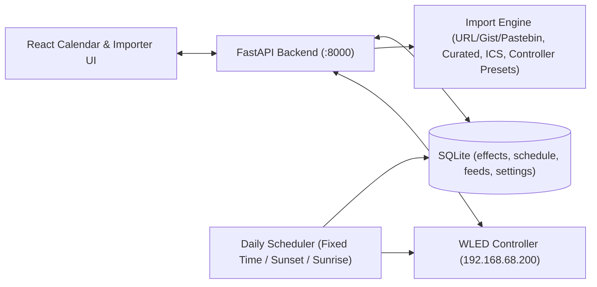

# WLED Calendar — Implementation Plan

## Goal Description

Build **wled-calendar**, a local web application (runnable locally or via Docker) that schedules and applies WLED lighting effects on a daily basis to the WLED controller at `192.168.68.200`, while respecting the controller's live hardware and configuration settings.

### Controller Baseline (`192.168.68.200`)
Querying the live controller revealed the exact hardware and software profile that `wled-calendar` will adapt to:
- **Firmware**: WLED `16.0.1` (`Niji`, ESP32), `220` effects (`/json/eff`), `74` palettes (`/json/pal`).
- **LED Topology (`1078` LEDs across 3 physical pins)**:
  - **Segment 0**: `start: 0`, `stop: 712` (`len: 712`, GPIO 16)
  - **Segment 1**: `start: 712`, `stop: 824` (`len: 112`, GPIO 3)
  - **Segment 2**: `start: 824`, `stop: 1078` (`len: 254`, GPIO 1)
- **Location & Time**: `ntp.en: true`, `lt: 43.45`, `ln: -112.03` (enabling accurate local sunset/sunrise scheduling).
- **Existing Presets**: Stored in `/presets.json` (e.g., `1: Sparkle-sunset`, `2: Lake-sunset`), which can be imported into the app's library.

---

## User Review Required

> [!IMPORTANT]
> **Architecture Choice**: The app uses a **Python (FastAPI + SQLite + APScheduler)** backend and a **React + TypeScript + Vite + Tailwind CSS** frontend. In production/Docker, FastAPI serves the built React bundle on a single port (`8000`), so there is only one process to run.

> [!NOTE]
> **Segment Mapping Behavior**: By default, any imported or curated effect is mirrored across all 3 controller segments (`0..712`, `712..824`, `824..1078`). Users can toggle per-segment overrides on any effect in the library or on a specific calendar day.

---

## Architecture Overview

---

## Proposed Changes

### 1. Project & Packaging Setup

#### [NEW] [pyproject.toml](file:///Users/austintalbot/src/wled-calendar/pyproject.toml)
Python project configuration managed with `uv`, including `fastapi`, `uvicorn[standard]`, `httpx`, `pydantic`, `pydantic-settings`, `apscheduler`, `astral`, `icalendar`, and `pytest` / `pytest-asyncio` / `respx` for testing.

#### [NEW] [Dockerfile](file:///Users/austintalbot/src/wled-calendar/Dockerfile) & [docker-compose.yml](file:///Users/austintalbot/src/wled-calendar/docker-compose.yml)
Multi-stage build (Node 22 builds `frontend/dist`, Python 3.12 runs FastAPI serving both `/api/*` and the static SPA) with a persistent volume for `wled_calendar.db`.

---

### 2. Backend Core & WLED Controller Adapter (`backend/`)

#### [NEW] [backend/config.py](file:///Users/austintalbot/src/wled-calendar/backend/config.py)
Environment-backed settings (`WLED_HOST=192.168.68.200`, `DB_PATH=./data/wled_calendar.db`, `PORT=8000`, `TIMEZONE=America/Boise`).

#### [NEW] [backend/db.py](file:///Users/austintalbot/src/wled-calendar/backend/db.py)
SQLite schema and lightweight migration helper with tables:
- `controller_profile`: cached `/json/info`, `/json/cfg` segments (`0..712`, `712..824`, `824..1078`), `lt`/`ln`, `effects` list, `palettes` list, `last_synced_at`.
- `effects`: `id`, `name`, `source_type` (`curated`, `url`, `json`, `wled_preset`), `source_url`, `payload_json` (normalized WLED state), `segment_mode` (`mirror` | `custom`), `tags`, `preview_colors`, `created_at`.
- `schedule_rules`: `id`, `rule_type` (`date`, `date_range`, `day_of_week`, `holiday`, `default`), `start_date`, `end_date`, `days_of_week`, `holiday_name`, `effect_id`, `trigger_type` (`fixed_time`, `sunset`, `sunrise`), `trigger_time`, `offset_minutes`, `brightness_override`, `priority`, `enabled`.
- `ics_feeds`: `id`, `name`, `feed_type` (`google_calendar` | `holiday_ics`), `url`, `sync_interval_minutes`, `last_synced_at`, `auto_map_keywords`, `enabled`.
- `calendar_events`: cached parsed events from synced feeds (`id`, `feed_id`, `uid`, `summary`, `description`, `start_dt`, `end_dt`, `is_all_day`, `matched_effect_id`, `match_source`).
- `execution_logs`: `id`, `scheduled_for`, `executed_at`, `effect_id`, `effect_name`, `trigger_source`, `status`, `error_message`.

#### [NEW] [backend/wled_client.py](file:///Users/austintalbot/src/wled-calendar/backend/wled_client.py)
Async `httpx` client for WLED JSON API:
- `sync_controller_profile()`: fetches `/json/info`, `/json/cfg`, `/json/eff`, `/json/pal`, `/presets.json` and extracts the physical segment boundaries (`hw.led.ins` / active segments), coordinates (`if.ntp.lt`, `if.ntp.ln`), and capability bounds (`fxcount=220`, `palcount=74`).
- `adapt_payload_to_controller(raw_state, profile, segment_mode="mirror")`:
  - Clamps `fx` and `pal` IDs within `[0, fxcount-1]` and `[0, palcount-1]`, or resolves effect/palette names to IDs if provided as strings.
  - Rewrites `seg` array to match the controller's exact 3-segment topology (`[0..712]`, `[712..824]`, `[824..1078]`), mirroring segment 0's `fx`, `pal`, `sx`, `ix`, `col`, `c1`, `c2`, `c3` across all segments when `segment_mode == "mirror"`, or preserving per-segment overrides when `segment_mode == "custom"`.
- `apply_state(state_payload)`: `POST http://{host}/json/state` with timeout/retry handling.

---

### 3. Multi-Source Import Engine (`backend/importers/`)

#### [NEW] [backend/importers/url_importer.py](file:///Users/austintalbot/src/wled-calendar/backend/importers/url_importer.py)
- Fetches WLED preset JSON from raw URLs, GitHub Gist URLs (auto-rewriting `gist.github.com/...` to raw), GitHub file URLs (`github.com/.../blob/...` -> `raw.githubusercontent.com`), and Pastebin URLs (`pastebin.com/...` -> `pastebin.com/raw/...`).
- Supports both single-preset JSON objects (`{"seg": [...]}`) and full WLED `presets.json` bundles (`{"1": {...}, "2": {...}}`), returning a list of normalized previewable presets for the user to select and import.

#### [NEW] [backend/importers/curated_library.py](file:///Users/austintalbot/src/wled-calendar/backend/importers/curated_library.py)
- Built-in catalog of 15+ seasonal, holiday, and everyday WLED presets (e.g., *Christmas Twinkle*, *Halloween Spooky*, *4th of July Fireworks*, *Autumn Harvest*, *Valentine's Pulse*, *St. Patrick's Emerald*, *Warm Sunset*, *Ocean Breeze*, *Aurora Borealis*, *Game Day*), resolved dynamically against the controller's `/json/eff` and `/json/pal` names so IDs are always accurate for WLED `16.0.1`.

#### [NEW] [backend/importers/ics_importer.py](file:///Users/austintalbot/src/wled-calendar/backend/importers/ics_importer.py)
- Fetches and parses both **Google Calendar Secret iCal URLs** (`https://calendar.google.com/calendar/ical/.../basic.ics`) and standard `.ics` holiday feeds using `icalendar` (handling recurring `RRULE` events and timezones).
- Extracts `VEVENT` start/end datetimes, all-day flags, summaries, and descriptions.
- **Smart Event-to-Effect Matching**:
  1. Explicit tag in title or description: `[wled: <effect_name>]` or `#wled:<effect_name>` (exact or fuzzy match against saved effects).
  2. Keyword mapping rules (e.g., `"Christmas"` -> *Christmas Twinkle*, `"Halloween"` -> *Halloween Spooky*, `"Birthday"` -> *Rainbow Party*, `"Game Day"` -> *Game Day*).

---

### 4. Daily Scheduler (`backend/scheduler.py`)

#### [NEW] [backend/scheduler.py](file:///Users/austintalbot/src/wled-calendar/backend/scheduler.py)
- Uses `APScheduler` (`AsyncIOScheduler`) + `astral` (with controller `lt=43.45, ln=-112.03` from `controller_profile`).
- **Periodic Google Calendar Sync**: Polls enabled `google_calendar` / `holiday_ics` feeds on their configured `sync_interval_minutes` (default 30 min) and refreshes `calendar_events`.
- **Daily & Timed Event Resolution**:
  - Evaluates today's highest-priority baseline rule (`date` > `google_all_day` / `holiday` > `date_range` > `day_of_week` > `default`) and schedules it at `fixed_time` or `sunset`/`sunrise` + `offset_minutes`.
  - Schedules **timed Google Calendar events** (`is_all_day = False`) at their exact `start_dt` (and optionally restores the day's baseline effect at `end_dt`).
  - Logs every execution (manual, daily rule, or Google Calendar event) to `execution_logs`.

---

### 5. REST API (`backend/routers/`)

#### [NEW] [backend/main.py](file:///Users/austintalbot/src/wled-calendar/backend/main.py)
FastAPI app lifecycle (initializes DB, syncs controller profile on startup if reachable, starts scheduler, mounts static frontend if `frontend/dist` exists).

#### [NEW] [backend/routers/controller.py](file:///Users/austintalbot/src/wled-calendar/backend/routers/controller.py)
- `GET /api/controller/status` — live `/json/state` + cached `/json/info` & `/json/cfg` segments.
- `POST /api/controller/sync` — refreshes profile, effects, palettes, and existing `/presets.json` from `192.168.68.200`.
- `POST /api/controller/apply` — immediately applies an effect ID or raw payload to the controller.

#### [NEW] [backend/routers/effects.py](file:///Users/austintalbot/src/wled-calendar/backend/routers/effects.py)
- `GET /api/effects`, `POST /api/effects`, `PUT /api/effects/{id}`, `DELETE /api/effects/{id}`.
- `POST /api/effects/import/url` — preview/import from URL/Gist/Pastebin.
- `POST /api/effects/import/json` — import pasted JSON.
- `GET /api/effects/curated` & `POST /api/effects/import/curated` — browse & import curated presets.

#### [NEW] [backend/routers/schedule.py](file:///Users/austintalbot/src/wled-calendar/backend/routers/schedule.py)
- `GET /api/schedule/month?year=YYYY&month=MM` — resolved day-by-day calendar view showing which effect will run on each day and at what time (including calculated sunset time).
- `GET/POST/PUT/DELETE /api/schedule/rules` — manage date, date-range, day-of-week, holiday, and fallback default rules.
- `GET /api/schedule/logs` — recent execution history.

#### [NEW] [backend/routers/feeds.py](file:///Users/austintalbot/src/wled-calendar/backend/routers/feeds.py)
- `GET/POST/DELETE /api/feeds` and `POST /api/feeds/{id}/sync` — manage and sync ICS holiday calendars.

---

### 6. Frontend Web App (`frontend/`)

#### [NEW] [frontend/package.json](file:///Users/austintalbot/src/wled-calendar/frontend/package.json) & Vite/Tailwind config
React 18 + TypeScript + Tailwind CSS + `lucide-react` icons.

#### [NEW] [frontend/src/App.tsx](file:///Users/austintalbot/src/wled-calendar/frontend/src/App.tsx)
Top navigation with live WLED controller status pill (`192.168.68.200` online/offline, current brightness, active effect, 1078 LEDs / 3 segments) and 4 main views:
1. **Calendar View** (`CalendarPage.tsx`): Monthly grid showing each day's assigned effect, color swatch, holiday badge, and computed trigger time (e.g., `Sunset 5:12 PM`). Clicking any day opens a drawer to assign/override an effect, set trigger time/sunset offset, or click **Apply Now**.
2. **Effect Library** (`EffectsPage.tsx`): Searchable grid of imported & controller effects with color previews, segment mode (`Mirror All 3` vs `Custom Segments`), per-segment editor (`Seg 0: 0–712`, `Seg 1: 712–824`, `Seg 2: 824–1078`), and **Test on WLED** button.
3. **Import Hub** (`ImportPage.tsx`): Tabs for:
   - *URL / Gist / Pastebin* (fetch, preview detected presets, and import)
   - *Paste JSON* (raw WLED preset JSON)
   - *Curated Library* (one-click seasonal/holiday effects)
   - *WLED Controller Presets* (import from `192.168.68.200/presets.json`)
   - *ICS / Google Calendar Feeds* (paste a Google Calendar Secret iCal URL or `.ics` holiday feed, configure auto-sync interval, and preview matched events with `[wled: ...]` tags or keyword rules)
4. **Controller & Logs** (`SettingsPage.tsx`): Controller IP config, segment topology inspector (`712 + 112 + 254 = 1078 LEDs`), location coordinates for sunset/sunrise, default daily fallback rule, and scheduler execution log table.

---

## Verification Plan

### Automated Tests
1. **Backend Unit & Integration Tests (`pytest`)**:
   - Mock WLED HTTP responses (`respx`) matching `192.168.68.200` (`ver: 16.0.1`, `1078` LEDs, 3 segments) to test:
     - `adapt_payload_to_controller` (mirroring 1-segment internet presets onto 3 segments `0..712`, `712..824`, `824..1078`, clamping out-of-range `fx`/`pal` IDs, preserving custom segment overrides).
     - URL rewriting & parsing for GitHub, Gist, Pastebin, single preset JSON, and multi-preset `presets.json`.
     - ICS / Google Calendar feed parsing (`[wled: ...]` tag extraction, keyword matching, all-day vs. timed events).
     - Schedule resolution priority (`timed_gcal_event` at start/end time; `date` > `google_all_day` / `holiday` > `date_range` > `day_of_week` > `default`) and `astral` sunset calculation.
   - Run command: `uv run pytest`
2. **Frontend Build & Typecheck**:
   - Run command: `cd frontend && npm run build` (runs `tsc` + `vite build`).

### Manual Verification
1. Start the backend + frontend locally (`uv run uvicorn backend.main:app --reload` and `npm run dev`), open `http://localhost:5173`.
2. Verify **Controller Sync** pulls live segments (`0..712`, `712..824`, `824..1078`), `220` effects, `74` palettes, and existing presets from `192.168.68.200`.
3. Import a preset via URL/JSON and one from the Curated Library, assign it to today's date in the Calendar, and click **Apply Now** (with user confirmation) to verify the lights at `192.168.68.200` update across all 3 segments.
